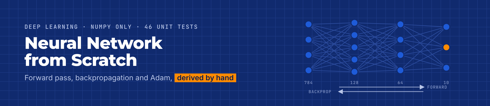
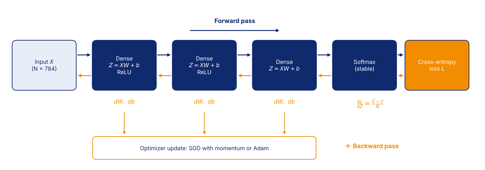

<!-- Add assets/banner.png (1280 × 400), then uncomment the next line. -->
<!--  -->

# Multiclass neural network from scratch in NumPy

A fully-connected neural network for multiclass classification, written with NumPy only. The forward pass, backpropagation, SGD with momentum and Adam are all derived and implemented by hand, and checked by 46 unit tests.


<p align="center">
  
  <br><em>Forward pass through dense layers, backward pass of the gradients, and parameter update by an interchangeable optimizer.</em>
</p>

## TL;DR

- **Question:** What does it take to build and verify a neural network without a deep learning framework?
- **Approach:** Dense layers, activations, softmax with cross-entropy, backpropagation, SGD with momentum, Adam, metrics and a preprocessing pipeline, in NumPy only.
- **Result:** About 1,000 lines of documented code with 46 unit tests. The network has not yet been trained on a real dataset, so no accuracy is reported.

## Motivation

Frameworks like PyTorch compute gradients automatically. Writing them by hand shows exactly how a network learns: how the error flows back through each layer, and why choices like He initialisation or Adam's bias correction matter. The target task is MNIST: 10 classes, 784 pixels per image.

## Method

The network is a stack of dense layers: `NeuralNetwork(layer_dims)`, for example `[784, 128, 64, 10]`. The idea is simple: compute predictions forward, measure the error, send the error backward to get each weight's gradient, then let an optimizer update the weights.

**Dense layer.** For an input batch $X$ of $N$ rows:

$$Z = XW + b, \qquad A = \mathrm{ReLU}(Z) = \max(0, Z)$$

Weights use He initialisation (variance $2/n_{\text{in}}$), which suits ReLU layers.

**Output and loss.** A numerically stable softmax subtracts the row maximum before the exponential. The loss is the cross-entropy, with probabilities clipped to avoid $\log 0$:

$$\hat{Y} = \mathrm{softmax}(Z), \qquad L = -\frac{1}{N}\sum_{i=1}^{N}\sum_{k} Y_{ik}\log \hat{Y}_{ik}$$

Softmax and cross-entropy are differentiated together, which gives a simple and stable gradient:

$$\frac{\partial L}{\partial Z} = \frac{\hat{Y} - Y}{N}$$

**Backpropagation.** Given the gradient $dZ$ at a layer's output:

$$dW = X^{\top} dZ, \qquad db = \sum_{i} dZ_i, \qquad dX = dZ\,W^{\top}, \qquad dZ_{\text{prev}} = dX \odot \mathbb{1}[Z_{\text{prev}} > 0]$$

**Optimizers.** Both inherit from an abstract `Optimizer` class, so they can be swapped without touching the training loop.

- *SGD with momentum:* $v \leftarrow \beta v - \eta\, \nabla_W L$, then $W \leftarrow W + v$.
- *Adam:* moving averages of the gradient and its square, with bias correction:

$$m_t = \beta_1 m_{t-1} + (1-\beta_1) g_t, \quad v_t = \beta_2 v_{t-1} + (1-\beta_2) g_t^2, \quad \hat{m}_t = \frac{m_t}{1-\beta_1^t}, \quad \hat{v}_t = \frac{v_t}{1-\beta_2^t}$$

$$W \leftarrow W - \eta\, \frac{\hat{m}_t}{\sqrt{\hat{v}_t} + \epsilon}$$

**Data pipeline.** The pipeline does a stratified 70/15/15 train/validation/test split, min-max or standard normalisation, and one-hot labels. Normalisation statistics are computed on the training set only, so no information leaks from validation or test.

**Metrics.** Accuracy, confusion matrix, and per-class precision, recall and F1, all in NumPy.

## Verification

| | |
|---|---|
| **Unit tests** | 46 tests in 7 files, at least one file per module |
| **What they check** | Shapes, activations and their gradients, loss values, optimizer updates, preprocessing and metrics |
| **End-to-end check** | The network overfits a mini-batch of 8 examples with SGD, then with Adam. If backpropagation were wrong, the loss would not go to zero |
| **Framework** | pytest |

## Limitations & next steps

- **Limitation:** The network has not been trained on a real dataset, and the gradients are checked by unit tests and the overfitting test, not yet by numerical gradient checking.
- **Next step:** Train `[784, 128, 64, 10]` with Adam on MNIST and compare it with a PyTorch model of the same architecture, then add a finite-difference gradient check.

## Reproduce

```bash
git clone https://github.com/CedricKonkobo/neural-net-scratch.git
cd neural-net-scratch
pip install -r requirements.txt
pytest tests/          # runs the 46 unit tests
```

`utils/load_dataset.py` downloads MNIST through scikit-learn (OpenML) into `data/raw/`.

## Repository structure

```
neural-net-scratch/
├── assets/          # figures used in this README
├── src/
│   ├── activations.py     # ReLU, sigmoid, stable softmax and their gradients
│   ├── layers.py          # Dense layer: forward, backward, He initialisation
│   ├── losses.py          # cross-entropy and combined softmax + CE gradient
│   ├── network.py         # NeuralNetwork: forward, backward, predict, mini-batch training
│   ├── optimizers.py      # Optimizer base class, SGD with momentum, Adam
│   ├── preprocessing.py   # split, normalisation, one-hot, full pipeline
│   └── metrics.py         # accuracy, confusion matrix, precision / recall / F1
├── tests/           # 46 unit tests
├── utils/           # MNIST download
├── requirements.txt
└── README.md
```

## References

1. D. E. Rumelhart, G. E. Hinton, R. J. Williams, *Learning representations by back-propagating errors*, Nature, 1986.
2. B. T. Polyak, *Some methods of speeding up the convergence of iteration methods*, USSR Computational Mathematics and Mathematical Physics, 1964.
3. D. P. Kingma, J. Ba, *Adam: A Method for Stochastic Optimization*, ICLR, 2015.
4. K. He, X. Zhang, S. Ren, J. Sun, *Delving Deep into Rectifiers*, ICCV, 2015.
5. Y. LeCun, L. Bottou, Y. Bengio, P. Haffner, *Gradient-based learning applied to document recognition*, Proceedings of the IEEE, 1998.

---

**Cédric Konkobo** · AI & Data Engineering, ENSAM Rabat · [GitHub](https://github.com/CedricKonkobo)
